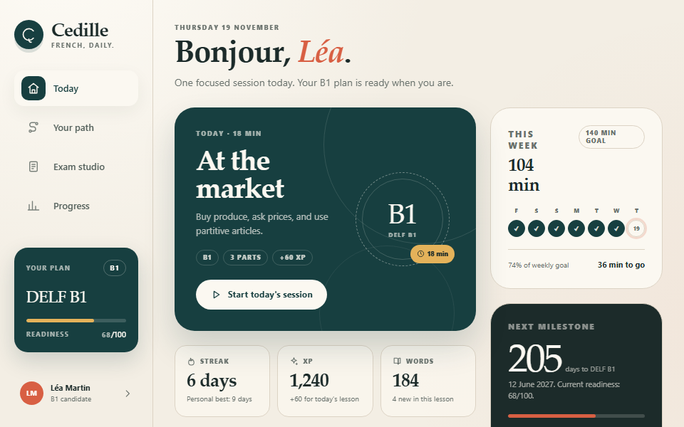

# Cedille

**A mobile-first French study app for DELF and DALF candidates: one session a day, exam practice under the clock, and an honest readiness score.**

[Live demo](https://french-delf-022115026037894092506.vercel.app) | HTML, CSS and JavaScript, no build step



Most French apps stop at streaks and vocabulary. Exam candidates need a habit that also teaches them
how the paper behaves. Cedille combines short lessons with timed DELF/DALF sprints, then turns the
results into one readiness estimate and one visible next step.

## What it does

- **Today.** A seeded B1 learner sees today's lesson, streak, weekly minutes, exam countdown, skill
  bars and a readiness score.
- **Lesson player.** Two complete lessons (Café survival, At the market) with vocabulary cards,
  browser French audio, listening comprehension, answer feedback and a completion summary.
- **Exam studio.** A five-minute, six-question timed sprint for DELF B1, DELF B2 or DALF C1 covering
  listening, reading, language and writing, with a 0 to 100 score, section breakdown and answer review.
- **Level check.** A five-question placement flow with A2/B1/B2 suggestions and an honest note that
  the demo ships one full B1 path.
- **Progress.** Readiness trend, skill bars, weekly minutes, lesson and word totals, exam history.
- **Profile and mobile shape.** Daily goal, exam date, reminder preference, demo reset, bottom tab bar,
  installable manifest and safe-area padding. No login wall.

## Run it locally

```bash
node dev-server.mjs
```

Open <http://127.0.0.1:5055>. Nothing to install.

## Verify

```bash
node verify.mjs
node smoke.mjs
```

`verify.mjs` checks the data model, answer indexes, required files, app wiring, the manifest and the
static routes over HTTP. `smoke.mjs` loads the app against a small DOM stub and walks the lesson,
exam, placement, progress and profile flows.

## How it is built

| Path | Purpose |
|---|---|
| `index.html` | The app shell |
| `data.js` | Seeded learner, lessons, exam banks, placement questions |
| `app.js` | State, routing, lesson and exam flows, French speech synthesis |
| `styles.css` | The visual system and mobile layout |
| `verify.mjs`, `smoke.mjs` | Verification |

State is stored in `localStorage`, so progress survives a refresh in the same browser.

## What is simulated

The learner, lessons, exam banks and placement questions are sample content, and progress lives in
the browser. Writing and speaking are sampled in the sprint but not deeply assessed, and the
interface says so rather than pretending otherwise.

## About this prototype

Built as a working prototype for a real brief, then published as part of a portfolio. This is an MVP,
not a production LMS: no accounts, payment, tutor marketplace, live speaking assessment, official
DELF scoring or cloud sync. The next build would add spaced repetition for missed items, a recorded
speaking drill with a rubric, a writing workshop with model answers, and accounts plus sync.
